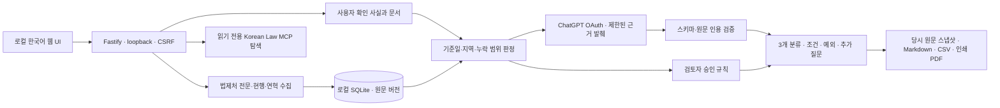

# 아키텍처와 판단 통제

## 적용법과 완전성

`Evidence`는 출처 식별자, 버전, 전문, 해시, 시행·공포·수집일, 지역, 전문·별표·연혁·사람 검증 상태를 저장합니다. 현행 국가법은 `eflaw`의 **목록이 반환한 시행일**과 MST를 함께 사용합니다. 임의의 오늘 날짜를 해당 MST의 시행일로 간주하지 않습니다. 조례의 현행·연혁 목록은 각각 `nw=1`, `nw=2`입니다.

저장된 자료에서 기준일에 시행 중인 후보를 고르며, 같은 계보는 그 시점의 최신 시행·공포 버전을 선택합니다. 한계는 명시적으로 남깁니다. 폐지·제명변경·조문별 분리시행·위임 관계 전체·경과조치의 완전성이 검토되지 않았으면 확정적인 준법 판단에 사용하지 않습니다. 검색 결과가 없거나 일부 페이지가 실패하면 이를 '해당 규정 없음'으로 바꾸지 않습니다.

별표 링크는 공식 law.go.kr 출처만 허용하며 파일 크기·개수와 추출 길이를 제한합니다. 추출 성공만으로 표·수치의 법적 검증을 완료하지 않습니다. 원본을 `.local/legal-attachments`에 보관하고 검토자가 대조해야 합니다. 별표 링크를 식별하지 못해도 본문에서 별표 참조가 있으면 미확인 상태가 남습니다.

## 판단 규칙

1. 질문의 서술과 LLM의 추출 사실은 그 자체로 확정 사실이 아닙니다. 별도의 추가 답변을 사용자 확인 사실로 기록합니다.
2. LLM의 `clear_risk`는 항상 `human_review`로 낮춥니다.
3. 인용은 해당 원문에 실제 존재하는 연속 발췌여야 합니다. 잘못된 인용은 삭제하고 판단을 보류합니다.
4. 승인 규칙은 명시된 근거 해시·정확한 인용·필수 확인 사실·예외 미적용·적용 지역·시행기간이 모두 맞아야 실행됩니다.
5. 검토 범위에 누락이나 질문이 하나라도 남아 있으면 검토 전체의 명확한 리스크 생성이 차단됩니다.
6. 회신·민원은 사실관계가 한정된 참고자료입니다. 법령과 같은 효력의 규칙 근거로 승격하지 않습니다.

인용의 문자열 일치는 법적 해석의 옳음을 증명하지 않습니다. 그래서 모델 판단과 사람 검토 규칙을 분리하고, 아직 검토한 운영 규칙을 기본 탑재하지 않습니다.

## 변경·지연 구분

- **수집 실패/오래된 캐시:** 수집 시각과 실패 상태로 표시합니다.
- **공보와 법령센터의 버전 불일치:** 원본 대조 기록이 있어야 판단합니다. 수집일 차이만으로 불일치를 선언하지 않습니다.
- **상위법 개정 후 조례 검토 필요:** 문언·위임·적용기간을 사람이 검토해야 합니다. 날짜가 늦다는 이유만으로 조례 위법·미정비를 확정하지 않습니다.
- 전문 해시가 바뀌면 이전 결과를 덮어쓰지 않고 `needsReview`를 표시합니다.

## 로컬 보안

서버는 `127.0.0.1`에만 바인딩합니다. Host·Origin 검증, SameSite HttpOnly 세션 쿠키와 CSRF 헤더를 사용합니다. OAuth state·nonce·PKCE·ID token 서명을 검증하고 취소·로그아웃 후 늦게 도착한 토큰 저장을 차단합니다. 자격증명 파일은 Windows DPAPI를 사용합니다. 모델 응답은 HTML로 실행하지 않으며 문서 안의 지시는 분석 대상 데이터로 취급합니다.

서비스 계정·다중 사용자 배포, 원격 공개 서비스, 자동 법적 신고/허가 제출은 현재 범위가 아닙니다.
