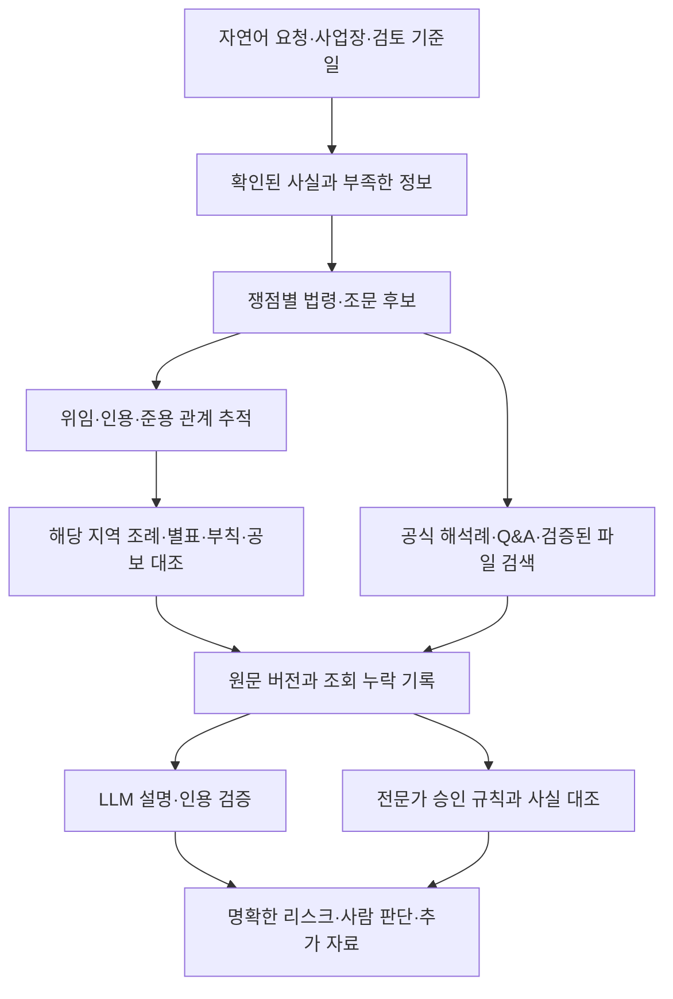

# EHS 서비스 개발 계획 — 첨부자료 검토 반영

작성일: 2026-10-04, 한국 시간. 대상 서비스: SH-E-Law-Check.

**기존 TypeScript 서비스에 조문 관계 추적과 공식 질의응답 검색을 추가한다. 첫 운영 검증은 경기도 화성시의 소량위험물 저장·취급으로 한정하고, 검증을 통과한 뒤 MSDS와 폐기물 업무로 확장한다.**

이번 작업은 첨부자료와 기존 코드의 검토 및 개발 계획 작성이다. 원본 엑셀·Python 코드·운영 서비스는 수정하지 않았다. 첨부 문서의 실행 명령이나 확장 제안은 검토 자료로 취급했다. 첨부 예제의 성공 기록을 이번 환경에서의 실호출 성공이나 법률 판단의 정확성으로 간주하지 않았다.

**첨부자료를 어떻게 사용할 것인가**

| 자료 | 확인 결과 | 개발에 반영할 방법 |
| --- | --- | --- |
| EHS_공공데이터_API_파일데이터_목록.xlsx | 전체목록 896건: 오픈API 161건, 파일데이터 735건. 핵심 표시 114건. 12개 분야 | 전체를 수집하는 작업 목록으로 삼지 않고, 업무별 데이터 공급원 후보 목록으로 관리 |
| EHS_법령조회_API_카탈로그.xlsx | 법령정보 API 가이드 항목 87건, 공공데이터 API 46건, 파일 29건 | 우선 연결할 API의 명세와 처리 단계 설계에 사용. 목록·본문 기능, 동일 원천의 재등록 항목은 묶어서 관리 |
| 파이프라인 가이드 및 README | 법 조문 → 위임 → 조례 → 해석례 → Q&A 순서와 알려진 응답 형태 정리 | 수집·검색 흐름과 명세 검증 체크리스트로 사용. 전국 완전성이나 법적 결론의 근거로 사용하지 않음 |
| Python 코드 7개 | 가이드 부록 코드와 파일 내용 일치. 읽기 전용 조회 시제품 | 조문번호 정규화, 응답 단건/복수건 처리, 위임 연결 방식을 기존 TypeScript 코드에 이식. 별도 Python 운영 서버는 우선 도입하지 않음 |
| 세 사례의 JSON·Markdown 6개 | 위험물·MSDS·폐기물 조회 결과와 누락·오탐 확인 가능 | 재현용 입력 및 회귀시험 후보. 예상 정답은 원문과 검토자 대조 후 별도 확정 |

건수는 엑셀 원시 행에서 재집계했다. 넓은 목록의 896개 URL은 서로 중복되지 않았다. 좁은 카탈로그의 공공데이터 75개 URL 중 47개가 넓은 목록과 겹쳐, 두 목록의 공공데이터 상세 URL 합집합은 924개다. 그러나 URL 수는 독립 데이터 원천 수나 필요한 API 키 수와 다르다. 좁은 카탈로그의 37개 API 행에는 이미 DRF 동일 데이터라는 메모가 있다. 이 메모도 실제 엔드포인트를 대조해 검증해야 한다.

참조 위치: 넓은 목록 `전체목록!A2:I897`, `핵심(★)!A2:I115`; 좁은 카탈로그 `1_법령정보API(law.go.kr)!A2:H88`, `2_data.go.kr 오픈API!A2:I47`, `3_파일데이터!A2:I30`, `4_실증결과!A2:K4`.

**그대로 도입하기 전에 고쳐야 할 사항**

| 우선도 | 근거와 발견 사항 | 서비스에서 필요한 처리 |
| --- | --- | --- |
| P0 | `pipeline.py:109`는 위임 대상 조문을 `[:3]`으로 제한. 폐기물 제17조 JSON에는 위임된 시행규칙 조문 6개 중 제16조의12·제17조의2·제17조의3만 본문 수집 | 전체 관계를 순회하거나, 미수집된 제17조의4·제18조·제18조의2와 중단 이유를 명시. 일부 조회를 완료로 표시하지 않음 |
| P0 | 가이드의 “연계 조례 0건이면 위임 없음” 설명은 데이터 누락 가능성 설명과도 충돌. `trace()`는 보완 검색 필요 메모만 남기며 `search_ordinance()`를 호출하지 않음 | 0건·오류·미승인·범위 제한을 구분. 조문 문언, 위임 정보, 해당 지역 조례 제목·본문 검색으로 보완하고 확인 상태 기록 |
| P0 | 세 예제 모두 notes에 권익위 API 미사용이라고 명시. Q&A 4·9·8건은 모두 CSV 검색 결과 | 발급받은 사용자 키로 공식 API 목록·상세·페이지 순회·오류 응답을 별도 검증. API 연결 성공과 CSV 검색 성공을 별도 표시 |
| P0 | `qna_api.py:17`, `law_api.py:13`은 HTTP 주소 사용. `http.py:54,56`은 인증값이 포함될 수 있는 요청 URL을 기록. `pipeline.py:188`은 OC가 들어간 인용 링크 생성 | HTTPS 지원 확인 후 HTTPS만 사용. 기존 보호 저장·인증값 제거 로직 재사용. 로그·내보내기·인용 URL에서 OC/serviceKey 제거 |
| P0 | 첨부 `trace()`에 기준일 입력이 없고, 법령명 정확 일치 실패 시 첫 검색 결과 선택. 목록의 공포 기준 버전과 본문의 시행 기준 버전이 분리될 수 있음 | 기존 서비스의 기준일·MST·시행일 검증 유지. 정확한 법령 식별, 현재/과거/시행예정 구분, 부칙·경과조치 검토 추가 |
| P0 | 경기도 사례 Q&A에 경남·울산·부산 답변이 포함. 폐기물 사례에는 경영상 해고 회시가 포함 | 법령·조문·쟁점·사실관계·지역·시점으로 관련성 평가. 다른 지역 회신은 유사사례로 표시하고 해당 지역 조례 적용 근거로 자동 채택하지 않음 |
| P1 | `local_qna.py:68`은 처음 발견한 날짜 컬럼을 선택. 예제에는 날짜 공란과 `1970-01-01`도 존재 | 신청일·처리일·등록일·실제 회신일 분리. 날짜 미상/비정상값을 따로 관리하고 최신 회신으로 정렬하지 않음 |
| P1 | `to_markdown()`은 본문을 기본 600자로 절단. 조례의 표·이미지 HTML, 별표와 고시 본문은 추적 흐름에서 충분히 처리되지 않음 | Markdown은 화면 미리보기로만 사용. 구조화된 전체 원문에서 필요한 조·항·호·목·별표를 발췌하고 원본 위치와 연결 |
| P1 | `_match_region()`은 명칭 접두사로 지역을 판단. 시·군·구와 개편 이력, 조례 제목 변경을 안정적으로 다루기 어려움 | 시도·시군구 코드 및 기준일별 명칭·소속 관계 관리. 기존 서비스의 17개 고정 목록도 함께 재검토 |
| P1 | 파일 캐시에 만료·재검증 정책 없음. 오프라인 옵션은 통신 실패를 `{}`로 반환하며 비JSON 응답도 빈 검색 결과처럼 흘러갈 수 있음 | 원본 응답 상태와 수집 실패를 보존. 캐시 생성일·재검증일·원문 해시·만료 상태 구분. 마지막 정상 자료를 사용할 때도 오래된 자료임을 표시 |
| P1 | 조례 17개, 연계 목록 5페이지, 해석례 상세 45건 등의 상한이 완전성 정보로 남지 않음. Q&A 페이지 순회·결과코드 검사도 보강 필요 | 작업별 예상/수집/실패/제외 건수와 상한 도달 상태 기록. 재시도 가능한 위치를 저장 |
| P1 | 키워드가 없으면 `kws[0]` 접근 가능. 해석례 ID는 target 구분 없이 중복 제거. CSV 결과에는 원본 행 식별자·문서번호·부서 등이 충분히 남지 않음 | 빈 입력 처리, 원천+target+문서ID의 복합 식별자, 원본 파일 해시+행 번호, 회신 문서번호·기관·부서 보존 |

예외 문구 정규식은 “검토할 문장 후보”를 찾는 데 재사용할 수 있다. 예외의 적용 요건을 확정하는 규칙으로 바로 바꾸면 안 된다. 예를 들어 “실험 목적”이라는 말뿐 아니라 해당 조항의 다른 요건과 예외가 적용되는 의무의 범위를 함께 확인해야 한다.

**기존 서비스와의 통합 방향**

현재 서비스는 React·Fastify·TypeScript·SQLite로 구현되어 있다. OC/ChatGPT 보호 저장, 법규 현행·연혁 수집, 원문 해시, 인용 검사, 세 가지 결과 분류와 검토자 승인 규칙을 활용한다. 기존 재검토 문서에 기록된 실행 성공은 과거 증거이며, 이번에는 앱 재시작이나 외부 계정 재검증을 수행하지 않았다.

| 기존 위치 | 유지·확장할 내용 |
| --- | --- |
| `server/sources.ts` | 기존 HTTPS·재시도·법규 버전 검증 재사용. 법규 본문 수집과 위임/해석례 어댑터 분리 |
| `shared/types.ts`, `server/schemas.ts` | 자료 유형별 날짜와 검증 상태, 조문 위치, 관계와 조회 범위 모델 추가 |
| `server/store.ts` | 전체 원문과 조문 단위 색인 연결. 법령의 시행일 필터를 회신·기술자료에 그대로 적용하지 않도록 조회 분리 |
| `server/vault.ts`, `server/app.ts` | 공공데이터 인증키 보호 저장·삭제·가린 상태 표시·서비스별 연결 시험 추가 |
| `server/reviews.ts`, `server/legal.ts` | 쟁점별 근거 묶음, 적용 조건·예외·누락 처리, 승인 규칙과 LLM 판단의 분리 유지 |
| `server/public-bundle.ts` | 현재 공개 법규 번들의 허용 범위 유지. 신규 데이터는 원천·이용조건·공개 가능성 검토 후 별도 등록 |
| `src/App.tsx`, `src/Tools.tsx` | 연결 상태, 출처별 자료 구분, 조문 관계, 부족한 사실, 원문·해석 비교 화면 확장 |

처음부터 외부 벡터DB나 새 클라우드 서비스를 추가하지 않는다. 조문 식별자·법령 관계·지역·시점 필터와 기존 검색을 먼저 개선하고, 평가 결과 어휘 차이 때문에 검색 누락이 남으면 의미 검색과 재정렬을 추가한다.

**필요한 데이터 구조**

| 구조 | 주요 필드와 목적 |
| --- | --- |
| 자료원 목록 | 원천ID, 포털ID, 기능ID, 제공기관, 역할(법적 근거/해석/기술자료/현황), 공식 URL, 인증 방식, 이용조건, 갱신주기, 실제 검증 상태 |
| 법규 버전·조문 | 법령ID/MST, 조·가지·항·호·목, 시행·공포·수집일, 적용기간, 원문 해시, 부칙·별표 위치, 원문 열람 주소 |
| 조문 관계 | 위임/인용/준용/예외/개정의 관계 종류, 출발·도착 조문 및 버전, 관계 확인 근거, 미해결 사유 |
| 해석·질의응답 | 원천별 ID, 질문·답변, 기관·부서·문서번호, 등록일·회신일, 관련 법령/조문, 해당 사실관계·지역, 날짜 신뢰 상태 |
| 수집 실행 | 대상·파라미터(인증값 제외), 시작/종료, 예상/확보 건수, 페이지·커서, 실패·상한·누락, 원문 해시 |
| 검토 근거 묶음 | 검토ID, 기준일·지역·확인 사실, 채택/배제한 자료와 사유, 확인해야 할 예외, 해당 시점 원문 버전 |

통계·업체 대장·민원 회신에는 법령의 시행일을 임의로 부여하지 않는다. “공식 데이터”라는 속성과 “법적 의무의 직접 근거”라는 속성은 별도로 관리한다.

**개발 순서와 단계별 완료 기준**

| 단계 | 구현할 내용 | 완료 기준 |
| --- | --- | --- |
| 1. 자료원·검증 상태 정리 | 두 엑셀에서 메타데이터 가져오기, 동일 원천 연결, 업무별 우선순위, 문서확인/캐시 재현/실호출/운영검증 구분 | 목록 수와 출처를 추적할 수 있고, 미호출 항목이 연결 완료로 표시되지 않음 |
| 2. 공식 Q&A 연결 | 이미 발급받은 권익위 키의 전용 입력·보호 저장, 목록·상세 수집, 오류코드·페이지·원문 식별자 처리 | 재시작 후 키 유지, 실제 목록·상세 확보, 잘못된 키·제한·0건을 구분, 로그와 내보내기에 키 없음 |
| 3. 조문 관계 추적 | `lsDelegated`, `lnkLsOrdJo`, `ordin`과 보완 검색, `expc`·고용노동부/환경 소관부처/소방청 해석례 연결 | 세 첨부 사례 재현. 폐기물 6개 하위 조문 모두 수집 또는 미수집 사유 표시. 지역·시점·조문번호 정확성 확인 |
| 4. 파일과 별표·예외 검토 | CSV/PDF/HWP/HWPX 등록, 파일 교체·인코딩·날짜·중복 처리, 조문·별표·부칙과 공보 대조 화면 | 원문 행/페이지까지 추적. 미해독 표·이미지는 누락으로 표시. 600자 미리보기만으로 판단하지 않음 |
| 5. 화성시 업무 검증 | 소량위험물 사실 입력, 지정수량 계산 근거, 경기도 조례 적용 조건·예외 검토, 3~5개 규칙 검토자 승인 | 정상·예외·경계·자료부족 사례가 예상 분류와 일치. 검토되지 않은 원문/규칙/사실로 명확한 리스크가 발생하지 않음 |
| 6. EHS 범위 확장·운영 | MSDS 제114조 → 지정폐기물 제17조 → 업종별 대기·수질·기계안전. 필요한 물질·기술정보·업체 조회 연결 | 업무 묶음별 검증 사례와 지원 범위 공개. 개정·실패·오래된 자료가 기존 검토의 재검토 필요 상태로 전달 |

단계 2의 사용자 키 입력을 기다리는 동안 단계 1과 3의 코드·모의 응답 검증을 진행할 수 있다. 파일 원문 확보와 전문가의 법규·사실 대조는 개발 완료와 분리해 추적한다. 현재 승인된 운영 규칙이 없으므로 규칙 승인 전까지는 사람 판단/추가 자료 분류가 주된 결과가 된다.

**자료 연결의 우선순위**

| 순서 | 자료 | 인증·준비 | 채택 이유 |
| --- | --- | --- | --- |
| 최우선 | 법제처 법령·위임·조례·해석례 API | 기존 LAW_OC의 해당 API 승인 범위와 응답 확인 | 기존 수집을 조문 관계 추적으로 확장하는 기반 |
| 최우선 | 권익위 민원정책 질의응답 API, 포털 15074671 | 사용자 발급 완료. 서비스 연결 시험 필요 | 공식 공개 Q&A 목록·상세 경로 |
| 우선 후보 | 공개민원 CSV 15164540, 노동포털 CSV 15167750 | 첨부에는 다운로드 검증 기록. 이번 환경에서는 공식 상세/실파일 확보 재확인 미완료 | 대량 회신 검색과 API 보완. 원본 확보·스키마·이용조건 검증 뒤 활성화 |
| 화학물질 업무 | 안전보건법령 스마트검색 15123696, 소방청 위험물 정보 15061055, 공단 MSDS 15157612 | 앞서 추천한 개별 활용신청. 사용자 승인 여부 미확인 | 현장 표현 검색과 제품·물질 정보 연결 |
| 추가 우선 후보 | 한국환경공단 화학물질 정보 조회 15149420 | 공식 제공 페이지 확인, 실호출은 미검증 | 물질명/CAS/KE와 물질 분류·함량·예외·고시정보 연결. 최종 적용은 원 고시와 제품 조성 대조 |
| 후속 후보 | KOSHA GUIDE API 15144147, 기술지침 목록·관련 질의회시집 | 원문·제공 범위·이용조건 확인 | 작업별 기술 권고와 점검 항목 보강 |
| 업무 확장 시 | 폐기물 처리업체·환경대행기관·인증서 확인 | 해당 기능을 개발할 때 필요한 서비스만 신청 | 업체·증빙 확인 지원. 목록 미등재만으로 무허가·위반 판정 금지 |
| 후순위 | 선임 현황, 재해·건강진단 통계, ESG·환경 측정 통계, 범용 교육자료 | 실제 화면 요구가 생길 때 선별 | 현황·교육·비교 기능. 법령 판단 검색에서 우선순위 낮춤 |

API 인증 방식은 자료원별로 확인한다. 포털에 등록된 법제처 API라도 원 서비스의 OC를 사용하는 항목이 있으므로 카탈로그 행마다 새 serviceKey가 필요하다고 안내하지 않는다. 파일 다운로드와 OpenAPI 활용신청도 구분한다. 키 값은 채팅·Git 코드·보고서에 넣지 않는다.

한국환경공단 화학물질 API는 CAS/물질명/고유번호 검색과 함량·예외·고시정보를 공식 페이지에서 안내한다. 개발단계 자동승인, 운영단계 심의승인으로 표시되어 있다. [공식 제공 페이지](https://www.data.go.kr/data/15149420/openapi.do)

**화성시 소량위험물 검토의 첫 운영 범위**

우선 제품 SDS, 성분·혼합물 정보, 최대 동시 저장·취급량과 단위, 저장 위치·구획, 옥내/옥외·탱크 여부, 취급 온도, 설비·환기·방유·소화 관련 사실, 기존 인허가/신고 문서, 검토 기준일을 입력받는다. 어떤 항목이 필요한지는 관련 조항과 쟁점에 따라 묻는다. 확인되지 않은 사실을 자동으로 “없음”으로 바꾸지 않는다.

자료는 국가법 → 관련 시행령·시행규칙·별표 → 경기도 조례·별표·부칙 → 해당 지역 공보·관련 시군구 규정 및 절차 → 쟁점에 맞는 해석·회신 순으로 연결한다. 모든 단계가 모든 사건에 적용된다고 가정하지 않으며, 필요한 범위와 미확인 범위를 기록한다.

출력에는 결론 분류, 적용한 원문과 버전, 확인된 사실, 적용 조건, 예외 검토, 부족한 정보, 사람이 판단할 쟁점, 다음 조치를 함께 표시한다. “명확한 리스크”는 AI의 확률 100%가 아니라 승인된 규칙의 요건 충족 여부로 정의한다.

첫 검증 사례는 다음을 포함한다.

1. 물질·수량·위치가 모두 확인된 기본 사례.
2. 제품 SDS가 없거나 혼합물 함량이 불명확한 사례.
3. 지정수량 계산의 경계와 여러 물질 합산이 문제되는 사례. 수치와 계산식은 검증된 법적 근거에서 가져온다.
4. 온도·용도·설비 조건에 따라 예외 적용 여부가 갈리는 사례.
5. 조례 별표 또는 공보 대조가 끝나지 않은 사례.
6. 다른 시도의 회신만 발견된 사례.
7. 과거 기준일과 개정 시행 전후의 적용이 달라지는 사례.
8. 허가 문서가 미제출된 사례. 문서 미제출을 무허가 사실로 바꾸지 않는다.

**검증과 운영 계획**

| 시험 영역 | 확인할 사항 |
| --- | --- |
| API 계약 | 단건/배열, 빈 응답, 비JSON, HTTP 200의 오류코드, 인증 실패, 호출 제한, 반복 페이지, 건수 변경, 중간 실패 |
| 조문 구조 | 제17조와 제17조의2 구분, 조·항·호·목 위치, 상위 의무와 예외의 연결, 별표 참조 누락 |
| 시점·지역 | MST/시행일 일치, 폐지·제명변경·경과조치, 시군구 관할, 과거 명칭, 다른 지역 회신의 구분 |
| 검색 품질 | 첨부 폐기물 사례의 해고 회시 같은 오탐 제거, 반드시 찾아야 할 근거의 누락, 낮은 관련성은 0건으로 남길 수 있는지 |
| 재현성 | 검토 당시 원문·파서 버전·조회 조건·채택/배제 이유 보존. 새 자료가 들어와도 과거 결과를 덮어쓰지 않음 |
| 보호·공개 | 인증정보 유출 없음, 외부 문서의 지시를 실행하지 않음, HTML 안전 처리, 파일 크기·시간 제한, 개인 문서의 Git 제외 |
| 기존 서비스 회귀 | 실질 변경 후 `npm run check`, 격리 DB의 `npm run test:e2e`, 공개 자료 변경 시 `npm run publish:check` |

세 첨부 사례는 출발점으로 사용하되 정답으로 고정하지 않는다. 업무별 정상·예외·누락·오류 사례를 보태 최소 20개 안팎의 평가 사례부터 만들고, 사람이 관련 근거와 기대 분류를 확인한다. 검색 정확도와 법률 결론의 정확도를 구분해 평가한다. 사례 수 자체를 품질 보증으로 사용하지 않는다.

수집 주기는 법규·회신·정적 파일의 제공 주기에 맞춘다. 요청할 때마다 전부 다시 받는 구조는 피하고, 변경 확인 후 필요한 버전만 수집한다. 주기 갱신 실패, 법규 변경, 별표 미확인, API 승인 만료를 화면에서 구분하고, 영향을 받는 기존 검토에 재검토 필요를 표시한다. 실제 토큰 만료 후 갱신과 예약 수집 실행도 과거 미관찰 항목으로 이어서 검증한다.

GitHub에는 코드·자료원 메타데이터·이용조건을 충족한 공개 법규만 기존 격리 수집·검사 절차로 저장한다. 사용자 사업장 사실·SDS·개인 민원·인증키·운영 DB는 로컬 보호 저장을 유지한다. 공개 회신 CSV도 공개 가능성을 검토하기 전에는 저장소로 자동 배포하지 않는다.

**다음 구현 작업의 구체적인 범위**

첫 변경 묶음은 “자료원 메타데이터 모델 + 권익위 API 전용 연결 설정 + 목록/상세 응답 검증”으로 잡는다. 다음 묶음은 “조문별 위임·조례 관계 추적 + 누락 표시 + 세 사례 회귀 검증”이다. 그다음 “별표·부칙·회신 관련성 검토”를 마친 후 화성시의 3~5개 승인 규칙을 준비한다.

사용자가 준비할 항목은 발급받은 키의 전용 설정란 입력, 우선 업무의 실제 사실·문서 제공, 규칙의 현장·법률 검토 담당자 지정이다. 키 입력 화면은 먼저 구현한 뒤 안내한다. 모든 후보 API를 미리 신청하거나 기존 OC·ChatGPT 연결을 재발급할 필요는 없다.

**검토 범위와 공식 확인 기록**

- 사용자 첨부 17개를 읽고, 엑셀 행·소스 코드·JSON/Markdown 예제를 비교했다. 추가 ZIP을 실행하거나 추출할 필요는 없었다.
- 원문 CSV 파일 자체는 첨부 폴더에 포함되어 있지 않다. 다운로드 방법과 예제에 포함된 검색 결과를 검토했다.
- 법제처 조례 연계 가이드에서 `lnkLsOrdJo`, JO 4자리·JOBR 2자리와 페이지 조회를 확인했다. 실제 승인 OC와 반환 식별자 매핑은 구현 단계에서 확인한다. [공식 가이드](https://open.law.go.kr/LSO/openApi/guideResult.do?htmlName=lsOrdinConListGuide)
- 권익위 공식 페이지에서 HTTPS 목록 주소, 등록일 검색, 목록/상세 제공과 인증키 요구를 확인했다. 이번에 사용자 키로 API를 호출하지 않았다. [공식 API](https://www.data.go.kr/data/15074671/openapi.do)
- 공개민원 CSV 15164540·노동포털 CSV 15167750·KOSHA GUIDE API 15144147은 이번 조회 도구/네트워크에서 페이지 재확인이 완료되지 않았다. 이것만으로 자료가 없거나 폐지되었다고 판단하지 않는다. 실제 파일·명세 확보를 해당 단계의 완료 조건으로 남긴다.
- 첨부의 “캐시를 이용한 실증”, 카탈로그의 “호출 확인” 표시는 작성자의 기록이다. 현재 서비스에서의 실시간 통합 검증과 분리한다.

입력 자료 폴더: `%USERPROFILE%/.aside/u/0/sessions/2026-10-04_Xjn0KEmK8uGoMqcd/artifacts/`

기존 서비스 폴더: `%USERPROFILE%/Documents/Codex/2026-10-02/1-x20/outputs/SH-E-Law-Check/`
