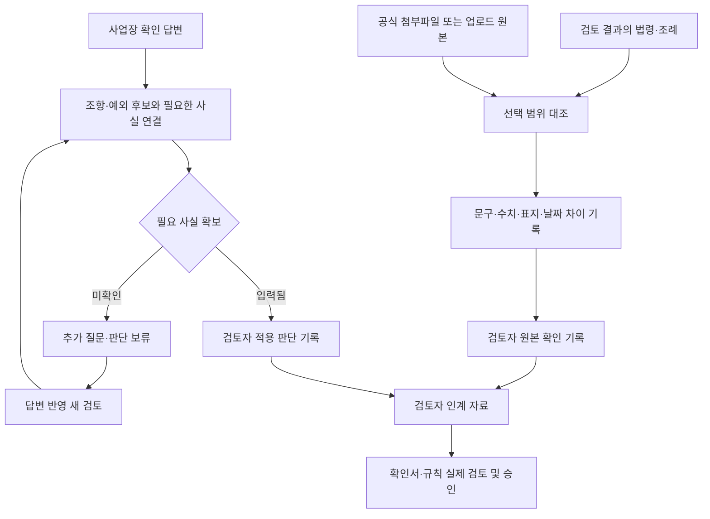

# 공보 대조·사업장 적용 검토

> 최신 재점검: [사실·원본·판정 점검](case-audit-2026-10-08.md), [32개 API 다섯 가지 조건](api-five-checks.md). 아래 기록은 이전 단계의 상태이며 현재 확보·미확보 상태는 최신 보고서를 따릅니다.
완료된 검토 결과의 **원본 대조와 사업장 적용 검토**에서 사용한다.

1. 경기도보·화성시 시보에서 첨부파일 주소를 확인해 가져오거나 자료함의 업로드 파일을 선택한다.
2. 법령과 공보·별표·부칙에서 같은 범위의 발췌를 지정한다. 문구, 수치·단위 후보, 별표·부칙·예외 표지, 사용자가 원본에서 확인해 입력한 공포일·시행일을 비교한다.
3. 원본의 표·수치·페이지를 검토자가 직접 확인하고 판단 이유를 기록한다. 자동 비교나 이 기록만으로 전체 법규 또는 판단 규칙이 승인되지는 않는다.
4. 사업장 사실과 조항·예외 후보를 대조한다. 필요한 사실이 빠지면 판단 보류만 기록할 수 있다. 추가 질문에 답하면 이전 검토를 보존한 새 검토가 생성된다.
5. 검토자 인계 자료(JSON)를 다운로드한다. 확인서 초안의 실제 검토 항목을 완성하여 연결 설정의 검토 확인서 등록으로 제출한다. 전문적 판단은 실제 검토자가 수행한다.

## 데이터 처리와 판정 범위

- 새 API 키는 필요 없다. 공식 파일 가져오기는 경기도청·화성시청·국가법령정보센터 HTTPS 첨부 주소를 지원한다. 다른 기관은 자료함 업로드를 이용한다.
- 다운로드 원본과 추출문은 기존 로컬 문서 저장소에 보관하며, 해시로 대조 기록과 연결한다. 원본·추출문·법령 버전·지역·기준일이 달라지면 이전 대조를 재사용하지 않는다.
- 검토자 판단은 법령 해시와 질문·기준일·사업장 답변 해시에 묶는다. 답변 변경 후 이전 적용 판단을 그대로 승계하지 않는다.
- 사실의 ‘입력 확인’은 입력값을 확보했다는 뜻이다. 측정·허가증 검증 또는 사실의 진실성을 인증한 결과가 아니다. 허가 미확인은 무허가가 아니다.
- 연결 사실은 원문 표현에 따른 후보이며 모든 법적 요건을 추론한 결과가 아니다. 최대 100개 후보를 표시하고 초과 범위를 미확인으로 남긴다.
- 숫자 비교는 수치 문자열 목록 비교다. 표 행·열 관계, 의미상 동등성, 단위 환산, 조문별 시행일 계산은 자동 확정하지 않는다.
- 공보 대표 시행일과 법령 메타데이터가 일치하더라도 조문별 시행 특례가 있을 수 있다. 날짜 일치가 해당 조항의 적용 승인을 뜻하지 않는다.
- PDF/HWP 추출 경고, 이미지·표 누락, OCR 필요 여부를 별도로 확인한다. 법령 API에 별표 메타데이터만 있고 파일 링크가 없으면 원본 확보가 남아 있다.
- 대조·검토자 기록은 보고서와 개인 백업에 포함된다. 복원 후 결과는 재검토 대상으로 표시된다. 확인 기록은 감사 이력이며 복원만으로 규칙 승인을 재생성하지 않는다.
- 선택 대조 자료는 다음 재검토의 문서 선택에 포함된다. AI 재검토를 요청하면 기존 정책에 따라 질문·선택 자료 발췌가 전송된다.

## 2026-10-08 검증

- 단위·서버 테스트: 총 199개 통과. 신규 9개는 위조 발췌 거부, 단위 누락, 미확인 허가, 원문·질문 변경 후 판단 무효화, 공식 파일 제한, 해시·범위 연결, 확인서의 비공개 연결 근거 승인, 백업 복원을 포함한다.
- 격리된 시험용 화성시 사례: 대조 저장 → 차이 표시 → 시험 검토자 기록 → 누락 사실 판단 보류 → 추가 답변 → 새 검토 → 대조 승계·이전 적용 판단 제외 → 인계 JSON → 새로고침·모바일 검증.
- 실수집: 법제처 OC의 `경기도 위험물안전관리 조례` 버전 `1914049`와 [경기도보 제7463호 PDF](https://www.gg.go.kr/cmmn/download.do?idx=832983)의 인쇄 38쪽(PDF 39쪽)을 대조했다. 해당 페이지 렌더링도 확인했다.
- 해당 공보와 법령의 선택한 부칙 발췌가 공백 정규화 후 일치했다. 일반 시행 문구와 특정 조항의 지연 시행 단서를 함께 확인했다. 전체 공보·모든 별표·법적 적용이 확인되었다는 결과는 아니다.
- 별지 제1·2호 서식은 해당 OC 응답에 메타데이터만 있고 다운로드 링크가 없어 원본 대조가 남아 있다.
- 실제 사업장 물질·농도·수량·시설·작업·허가·설치일은 아직 미확인이다. 실제 위반 판정이나 전문가 승인 기록을 생성하지 않았다. 시험용 데이터는 운영 DB와 분리했다.

개발 검증 명령: `npm run check`, `npm run test:e2e`, `npm run test:e2e:intake`, `npm run test:e2e:verification`, `npm run test:e2e:dossier`.
