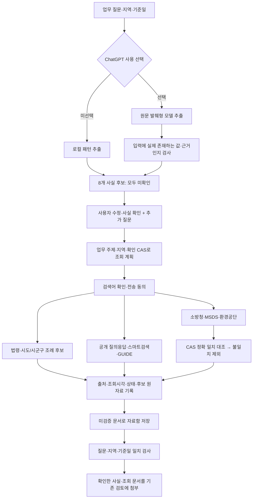

# 자연어 질문 → 사실 확인 → 자동 조회

2026-10-07 구현. 개발 순서 1·2를 연결한 첫 기능이다. 법적 적용·예외 검증까지 완료한 결과가 아니라 자료 탐색 기록을 만든다.

## 사용하는 순서

1. **새 법규 검토**에서 업무 상황, 소재 시·도·시군구, 검토 기준일을 입력한다.
2. **질문 분석과 자동 조회 → 1. 질문에서 사실 추출**을 누른다. ChatGPT 선택과 모델 지정 시 질문을 모델에 전송한다. 선택하지 않으면 로컬 패턴으로 추출한다.
3. 물질·CAS·농도·수량·시설·작업·허가·설치시점 8개 항목의 후보값과 근거 문장을 읽고 수정한다. 확인한 항목만 **사실 확인**을 선택한다. 미확인·모름은 확정 사실에 포함하지 않는다.
4. **2. 확인한 정보로 조회 계획 만들기**를 누른다. 대상 기관·검색어·조회 이유·추가 질문을 확인한다.
5. 표시된 검색어의 전송과 기록 저장에 동의한 뒤 **3. 계획대로 자동 조회**를 누른다. 저장된 OC와 계획에 표시된 서비스의 키를 사용한다. GHS·결정례·재해사례가 추가되었으며 전송할 날짜·구분 조건도 계획에 표시된다.
6. 출처별 후보·0건·실패·보류와 원자료를 확인한다. **이 조회 자료로 검토 시작**을 누르면 조회 기록과 사용자가 확인한 사실을 기존 검토에 연결한다.

위쪽의 기존 **검토 시작**은 자동 조회를 거치지 않는 기존 경로다. 자연어 분석 후 자동 조회하려면 아래 새 패널의 순서를 사용한다. 지역과 기준일은 폼의 선택값을 기준으로 하며, 질문과 다른 후보를 발견하면 대조 안내를 표시한다.

## 연결 구조

## 실제 조회 범위

| 자료 | 자동 처리 | 남는 확인 |
|---|---|---|
| 국가법령 | 관련 법명으로 목록 검색, 최대 5개 후보·공식 링크 보존 | 기준일의 전문·별표·부칙·위임 관계 |
| 시도·시군구 조례 | 지역명과 업무 주제로 목록 검색 | 0건은 규정 부재의 증명이 아님. 다른 명칭·공보·위임 규정 대조 |
| 민원정책 공개 질의응답 | 내용 검색, 첫 페이지 최대 3건, 첫 후보 상세 회신 | 질문과의 관련성·회신 당시 사실 및 법령 대조 |
| 스마트검색 | 전체 분류 검색, 첫 페이지 최대 3건 | 분류별 페이지 전체·최신 원문 대조 |
| KOSHA GUIDE | 목록 최대 3건, 원문 다운로드 링크 보존 | PDF 본문 수집·검토 및 법적 의무와 구별 |
| 소방청·환경공단 | 확인한 CAS 번호로 검색, 응답 CAS 정확 일치 확인 | 실제 제품 동일성·농도·기준일별 지정 |
| 공단 MSDS | CAS 검색 후 정확 일치한 첫 후보의 16개 항목 조회 | 제품 공급자 SDS와 대조; 일부 항목 실패는 부분 누락 표시 |
| CAS 미확인 | 확인된 물질명으로 MSDS 후보만 검색 | 소방청·환경공단 조회 보류, 물질명→CAS 자동 확정 안 함 |

API가 부분일치 후보를 반환할 수 있다. 실응답에서 `67-56-1` 검색에 `867-56-1`이 함께 반환되어 자동 조회에는 정확히 일치한 CAS만 포함하도록 보강했다. 제외한 제목·CAS·응답 해시도 기록한다. 일치 후보가 첫 페이지에 없으면 보류로 표시하며 잘못된 후보의 상세를 조회하지 않는다.

## 통제와 제한

- 모델은 질문의 연속 원문만 발췌한다. 추론한 CAS·단위변환·없는 근거 문장·중복 사실 항목은 수용하지 않는다. 추출값을 자동으로 확정하지 않는다.
- 현재 조회 계획은 업무 주제 규칙으로 만든다. 위험물·화학물질·사다리·추락·밀폐공간·작업환경측정·폐기물·대기·폐수 범주를 지원한다. 자유로운 모든 업종·법명을 의미적으로 찾아내는 엔진은 아직 아니다.
- 최대 업무 주제 2개·법명 3개·CAS 2개. 제외한 주제·성분은 안내한다. 전체 검색 결과가 아닌 첫 페이지의 제한된 후보를 보존한다.
- 후보 순위는 기관 반환 순서다. 관련성 재순위화·다단계 쿼리 확장·전체 페이지 수집은 아직 없다. 무관한 회신이 앞에 있을 수 있다.
- 기관 한 곳이 실패해도 다음 조회를 계속한다. 완료는 작업 종료를 뜻하며 모든 출처의 성공을 뜻하지 않는다.
- 수집 기록은 미확인 문서다. 승인된 근거·규칙으로 승격하거나 `clear_risk`를 생성하지 않는다. 허가 미확인을 무허가로 바꾸지 않는다.
- 질문·지역·기준일 변경 시 화면의 계획을 초기화하고 서버에서도 이전 계획의 검토 연결을 거절한다. 사실 수정 후에는 새 계획과 전송 동의가 필요하다.
- 질문 전체는 공공 API로 전송하지 않는다. 표시한 검색어만 전송한다. 모델 추출은 기존 ChatGPT 선택·모델 전송 안내를 사용한다.
- 연결 키와 인증 URL은 기록에 포함하지 않는다. HTTP 오류는 인증값 없는 일반 메시지로 표시한다.
- 작업 중 백업·복원·종료 등과 충돌하지 않도록 기존 작업 잠금을 사용한다. 서버 재시작 시 중단된 작업을 실패로 표시한다.
- 작성 중 계획을 화면 새로고침 후 자동 복원하는 기능은 아직 없다. 완료된 TXT 기록은 자료함과 기존 백업에 포함된다. 미완료 초안은 로컬 DB에만 있으며 백업 대상이 아니다.
- 기록은 최대 1MB다. 기존 모델 검토의 문서 발췌 한도를 초과하면 누락 경고가 표시된다. 수집한 원자료 전부가 모델 문맥에 들어갔다고 간주하지 않는다.

## 구현 위치

- `shared/intake.ts`: 8개 사실·계획·단계 상태 계약
- `server/intake.ts`: 발췌 검증, 계획, 출처 조회, CAS 대조, 기록 및 검토 연결
- `src/Intake.tsx`: 사실 확인·조회 계획·실행·결과 화면
- `server/app.ts`: 기존 인증·작업 잠금 아래 경로 등록, 검토 입력 연결
- `tests/intake.test.ts`: 부정·미확인·원문 환각·실패 격리·동의·CAS 부분일치·계획 결속
- `scripts/e2e-intake.mjs`: 독립 DB·가상 기관 응답을 사용하는 화면 전체 흐름 시험

## 검증

`npm run check`에서 전체 106개 시험 통과. 기존 E2E·공공 API E2E·신규 intake E2E 모두 독립 시험 DB에서 통과했다. 화면 시험에는 실제 계정·키를 사용하지 않는다.

실제 OC·6개 키로 별도의 **가상 메탄올 저장 사례**를 조회했다. 국가법령·경기도 조례·화성시 조례·6개 서비스에서 실제 응답을 확인했다. 화성시 위험물 키워드 0건을 규정 부재로 판정하지 않았다. 실연동 기록은 비공개 로컬 자료함에 저장하며 Git에 포함하지 않는다.

최종 실연동은 16개 조회 단계 중 후보 확보 15개·검색 0건 1개·실패 0개였다. MSDS 검색의 다른 CAS 1건을 제외하고 정확 일치한 물질만 보존했다. 실제 연결된 ChatGPT 모델로도 별도의 가상 질문에서 메탄올·CAS·99%·500리터를 원문 그대로 추출하고 8개 항목을 모두 미확인 상태로 시작하는 것을 화면에서 확인했다.

다음 단계는 후보 관련성 확인, 기준일별 전문·별표·부칙·예외 추적, 사실–근거 결속 및 검토자 승인이다. 이를 마쳐야 법적 판단 범위를 확장할 수 있다.

## 2026-10-08 조회 확장

공공자료 수동 조회는 32개 서비스 전체를 지원한다. 자연어 계획에는 확인된 CAS의 GHS, 기준일까지 최근 5개 연도의 결정례, 관련 재해사례를 추가했다. 인증번호·사업장 식별자·필지 정보는 추정하지 않으며 추가 입력이 필요하면 확인사항으로 남긴다. 재해사례 API가 검색 조건을 반영하지 않는 실제 응답이 있어 현재 페이지의 제목·업종으로 후보를 걸러내고 제외 범위를 표시한다. 조회 자료가 없거나 관계를 확인하지 못한 경우를 법규 부재·위반으로 승격하지 않는다.
